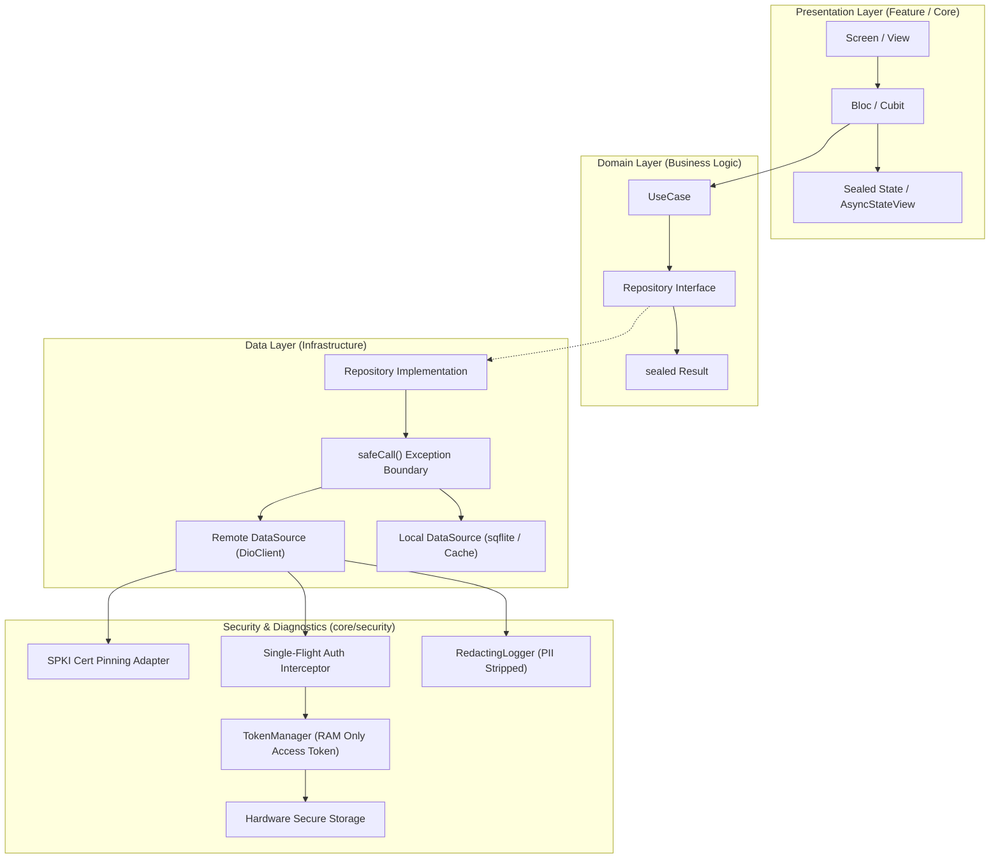

# Production-Grade Flutter Base Template

A modern, production-hardened Flutter Clean Architecture base template strictly isolating the `core/` infrastructure layer. Built with the latest stable Flutter 3.x / Dart 3.x standards and aligned with **OWASP MASVS Level 2** security guidelines.

---

## 🏗 Architecture Overview



---

## 📁 Project Structure

```
lib/
 ├─ main.dart, main_dev.dart, main_staging.dart, main_prod.dart
 ├─ bootstrap.dart               (Zoned error guard, observers, DI init, orientation, system UI)
 ├─ app.dart                     (MaterialApp.router, theme, locale, global decorators)
 ├─ core/
 │   ├─ config/                  (Flavors, env defines, feature flags, remote config hooks)
 │   ├─ constants/               (API endpoints, storage keys, durations)
 │   ├─ di/                      (Injectable setup, modules, get_it registration)
 │   ├─ error/                   (Sealed AppException & Failure, ErrorMapper, global handler)
 │   ├─ result/                  (Sealed Result<T>: Success/Failure, safeCall boundary)
 │   ├─ network/                 (DioClient, typed methods, interceptors, Isolate JSON parsing)
 │   ├─ database/                (sqflite SQLite, DAOs pattern, migrations, typed entities)
 │   ├─ router/                  (Typed GoRouter, auth guards, page transitions, observers)
 │   ├─ theme/                   (Material 3 ColorScheme, AppTheme, ThemeExtensions, ThemeCubit)
 │   ├─ responsive/              (Window size classes, AdaptiveLayout, AppSpacing, Gap, insets)
 │   ├─ notifications/           (Local + Firebase push notifications facade & checklist)
 │   ├─ services/                (Storage, permissions, analytics, crash reporting, connectivity)
 │   ├─ localization/            (Flutter gen-l10n, ARB files, LocaleCubit)
 │   ├─ usecases/                (Base UseCase and StreamUseCase)
 │   ├─ utils/                   (Extensions, validators, formatters, debouncer, throttler)
 │   ├─ widgets/                 (Accessible AppButton, AppTextField, state views, showcase)
 │   └─ security/                (OWASP MASVS: TokenManager, cert pinning, RASP, app lock)
 └─ features/                    (Clean architecture feature-first modules + README.md)
```

---

## 🚀 Getting Started

### 1. Install Dependencies
```bash
flutter pub get
```

### 2. Run Code Generation (`build_runner`)
```bash
dart run build_runner build -d
```
To watch for continuous changes during development:
```bash
dart run build_runner watch -d
```

### 3. Generate Localizations
```bash
flutter gen-l10n
```

### 4. Run the Interactive Showcase
The app boots directly into an interactive showcase screen featuring live theme toggling, animations, responsive adaptive layouts, and an interactive `Result<T>` network simulation pipeline:
```bash
flutter run
```

---

## 🎯 Environments & Flavors

Flavors use `--dart-define-from-file` to keep credentials decoupled and reproducible:

| Flavor | Entrypoint | Configuration File | Command |
| :--- | :--- | :--- | :--- |
| **Development** | `lib/main_dev.dart` | `env/dev.json` | `flutter run -t lib/main_dev.dart --dart-define-from-file=env/dev.json` |
| **Staging** | `lib/main_staging.dart` | `env/staging.json` | `flutter run -t lib/main_staging.dart --dart-define-from-file=env/staging.json` |
| **Production** | `lib/main_prod.dart` | `env/prod.json` | `flutter run -t lib/main_prod.dart --dart-define-from-file=env/prod.json` |

Pre-configured launch configurations are also included in `.vscode/launch.json`.

---

## 🔒 Security Layer Highlights (OWASP MASVS)

- **In-Memory Access Tokens**: Access tokens are held **in RAM only** and never touch disk.
- **Hardware-Backed Refresh Tokens**: Persisted exclusively in iOS Keychain / Android Keystore.
- **Single-Flight Proactive Refresh**: Concurrency mutex coordinates simultaneous 401 retries.
- **Dual SPKI Certificate Pinning**: Enforces SHA-256 public key digests with automatic fail-safe.
- **Redacting Diagnostics**: PII (emails, cards, passwords, Bearer tokens) stripped before logging.
- **Privacy Shield**: Blurs screens in the recent apps task switcher (`SecureScreen`).

---

## 📦 How to Enable Optional Packages

All optional integrations appear commented in `pubspec.yaml` with zero compile-time impact:

| Feature | Packages to Uncomment in `pubspec.yaml` | Implementation Files |
| :--- | :--- | :--- |
| **Firebase Cloud Messaging** | `firebase_core`, `firebase_messaging` | `lib/core/notifications/firebase_messaging_service.dart` |
| **Local Notifications** | `flutter_local_notifications`, `timezone` | `lib/core/notifications/local_notification_service.dart` |
| **Hardware Secure Storage** | `flutter_secure_storage` | `lib/core/security/secure_token_storage.dart` |
| **Image Caching** | `cached_network_image` | `lib/core/widgets/display/app_network_image.dart` |
| **Biometric Authentication** | `local_auth` | `lib/core/security/app_lock_service.dart` |
| **Remote Config** | `firebase_remote_config` | `lib/core/config/remote_config_hook.dart` |
| **Crashlytics / Sentry** | `firebase_crashlytics` / `sentry_flutter` | `lib/core/error/global_error_handler.dart` |
| **Lottie / Rive** | `lottie`, `rive` | `lib/core/widgets/animations/optional_animation_wrappers.dart` |
| **SQLCipher Encryption** | `sqlcipher_flutter_libs` | `lib/core/database/app_database.dart` |

---

## 🧪 Running Tests & Quality Checks

Run the complete test suite:
```bash
flutter test
```

Run static analysis:
```bash
flutter analyze
```
# flutter-base
# buzzer-app-flutter
